# open_HOWI

**A free, open-source "slicer" for 4-axis CNC hot-wire foam cutters**: prepare a part, preview
the cut, export G-code and run the machine from one app, the way PrusaSlicer works for 3D printers.

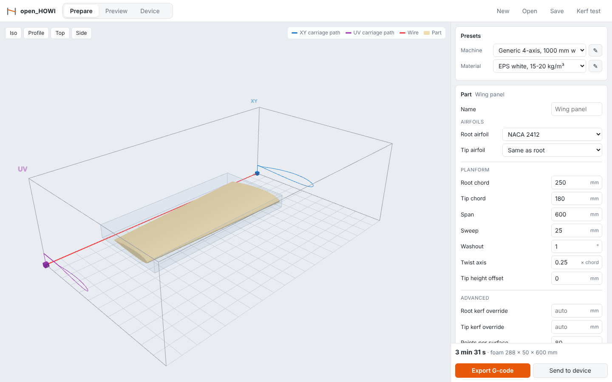

## Why

Many hobbyists and small shops use **DevFoam** or **Profili** to make G-code for their
hot-wire foam cutters and to drive the machine. Both programs cost money. Many of these
setups also depend on an old PC with a **parallel (LPT) port** that sends step/direction
signals straight to the stepper drivers. Modern computers don't have that port, and the
old machines that do are getting harder to keep running.

Others buy **DevWing Foam 2** (about 70 € a year, or 175 € for a lifetime licence) for its wing
features. open_HOWI covers the same ground for free (see the comparison below).

open_HOWI is a free alternative that:

- runs on any current computer (Linux, Windows, macOS, or a Raspberry Pi next to the machine);
- talks to the machine over **USB** through a cheap GRBL-style controller board, so the
  timing-critical step pulses come from the microcontroller, not from the PC;
- writes plain, readable G-code that other controllers (LinuxCNC, etc.) can run too.

| Wing CAM feature | open_HOWI |
|---|---|
| Airfoil `.dat` files | Selig and Lednicer, plus a built-in database of 68 model airfoils and NACA 4-digit sections |
| DXF import | DXF and SVG, for 2D shapes, fuselage views and wing planforms |
| Wing plan from an image | Trace the plan in a drawing program and load the outline: the wing is cut to it |
| Kerf settings | Per material, at full and half speed, worked out for each end of the panel; a kerf test cut |
| Washout, sweep, taper | Yes |
| Dihedral | Tip height offset, height per station, joiner holes angled for the dihedral |
| Spars | Any number of spar-cap slots, top and/or bottom, straight from root to tip |
| Ailerons | Ailerons, flaps and elevators cut off in the same cut, with a V for the hinge |
| Trailing-edge thickness | Yes, plus LE/TE stock and sheeting allowance |
| Lightening holes | Round spanwise holes (the servo channels) reached through a slit; holes in 2D shapes |
| Elliptical and curved wings | Split automatically into straight panels within a tolerance |
| Nesting | Both hands, or several wing panels and 2D shapes, cut from one block in one go |
| G93 inverse-time feed | Yes (the default) |
| Cutting simulation | Live 3D preview, playback, and a built-in GRBL simulator |
| Machine control | Built in: USB to GRBL, jog, zero, start/pause/stop |
| Price, systems | Free (GPL-3.0); Linux, Windows, macOS |

Not there yet: rotating a swept panel in the block ("rotate planform").

## Install

Download the installer for your computer from the
[latest release](https://github.com/ccarl0/open_HOWI/releases/latest). No Python needed:

| Your computer | Download | Then |
|---|---|---|
| Windows 10/11 | `open_HOWI-…-windows-setup.exe` | Run it and follow the steps; start open_HOWI from the Start menu. Windows may warn about an unknown publisher: *More info → Run anyway*. (A portable `.zip` is there too.) |
| Mac with Apple silicon | `open_HOWI-…-macos-arm64.dmg` | Open it and drag open_HOWI to Applications. The first time, right-click it and choose *Open*: the app is not signed by Apple. |
| Linux (x86-64) | `open_HOWI-…-linux-x86_64.tar.gz` | Unpack it and run `./install.sh`. open_HOWI appears in your applications menu (`./install.sh --uninstall` removes it). It carries its own web engine, hence the size. |

open_HOWI opens in **its own window**, with a File / View / Help menu, the system's Open and Save
dialogs and the usual shortcuts (Ctrl+N, Ctrl+O, Ctrl+S, Ctrl+E; ⌘ on a Mac). It runs only on your
computer and works offline. Starting it again while it runs brings its window to the front. Closing
the window quits; if a cut is running, it asks first and stops it (the wire switches off).

The window uses the web engine the system already has: Edge WebView2 on Windows (part of Windows 11
and of current Windows 10), WebKit on a Mac. Where there is none, open_HOWI opens in the web browser
instead, with a **Quit** button at the top right. Without 3D graphics (WebGL) everything but the 3D
view still works.

**With Python 3.11 or newer** (Intel Macs, or any other system):

```bash
pipx install git+https://github.com/ccarl0/open_HOWI   # or: pip install open_howi-<version>-py3-none-any.whl
open-howi            # the app in its own window (on Linux: pipx install "open-howi[window] @ git+…")
openhowi gui         # the same app in your web browser, and the command line: openhowi --help
```

### On a Raspberry Pi next to the machine

The Pi runs open_HOWI and drives the cutter over USB; you use it from a laptop, tablet or phone on the
same network, in the browser. Your computer need not stay on during a long cut. On the Pi (Raspberry
Pi OS Bookworm or later, or any Debian-based Linux with systemd):

```bash
curl -fsSL https://raw.githubusercontent.com/ccarl0/open_HOWI/main/packaging/raspberry-pi/install.sh | bash
```

It installs open_HOWI, lets it use the USB port, asks for a password, and sets it to start whenever the
Pi boots. At the end it shows the addresses to open, e.g. `http://raspberrypi.local:8765`; the app
shows them too, in the Device tab. Options go after `bash -s --`:

- `--password PASS` or `--no-password`: other computers are asked for the password (any user name);
  the Pi itself never is. Without one, anyone on the network can move the machine and switch the wire
  on: only do that on a network you trust.
- `--kiosk`: also show open_HOWI full screen on a display attached to the Pi (a touchscreen on the
  cutter), at start-up.
- `--port N`, `--no-service`, `--uninstall`, `--dry-run` (show what it would do), `--help`.

By hand, on any computer: `openhowi gui --host 0.0.0.0 --password …` (or set `OPENHOWI_PASSWORD`).

The installers are built by GitHub Actions (`.github/workflows/release.yml`) for every version tag:
`git tag v0.1.0 && git push origin v0.1.0` builds them all, checks each one starts, and publishes the
release. Publishing a release with a new tag from GitHub's *Releases → Draft a new release* page works
too: the files are added to it a few minutes later. `packaging/` holds the PyInstaller recipe, the
Windows installer script and the Linux install script.

## The app

```bash
pip install .        # from a checkout; Python 3.11+
open-howi            # the app in its own window
openhowi gui         # or in your browser, at http://localhost:8765
```

The interface is the same in the app window and in a browser; slicing and the USB connection run in
the `open_HOWI` / `openhowi` process on your computer. It works offline.

| Tab | What it does |
|---|---|
| **Prepare** | Choose a **machine** and a **material** preset, then set up the part: a **wing** (a straight panel, or an elliptical, curved or drawn half wing split into straight panels; root/tip airfoils from the built-in database, NACA or any `.dat` file, chords, span, sweep, washout, sheeting allowance, LE/TE stock, trailing-edge thickness, spar slots, servo channels, joiner holes, servo bays and a control surface), a **fuselage** (stations or side/top drawings, cut in two views, turned or as rounded lengthwise segments), a **2D shape** from a DXF or SVG drawing, or a **block of parts** nested in one foam block. The part, the foam block and both carriage paths update live in 3D as you type. |
| **Preview** | Estimated time, cut lengths, kerf at each end, peak carriage speeds, the foam block you need and where to put it. Scrub or play back the cut with the timeline: the cut appears in the foam as the wire passes, and at the end the pieces lift out of the block. **Timelapse** plays every cut of the part in about 15 seconds, with what to do at each pause (the block turns for a turned fuselage); **Save video** records it to share. Export G-code. |
| **Device** | Connect over USB (or to the built-in **simulator**), live position, jog both carriages together or separately, home, unlock, set zero, wire on/off, start/pause/resume/stop the job, console. When a job stops for you (e.g. to turn the foam), it says what to do; press Resume. A **STOP** button (feed hold + reset, wire off) stays in the top bar while connected. |

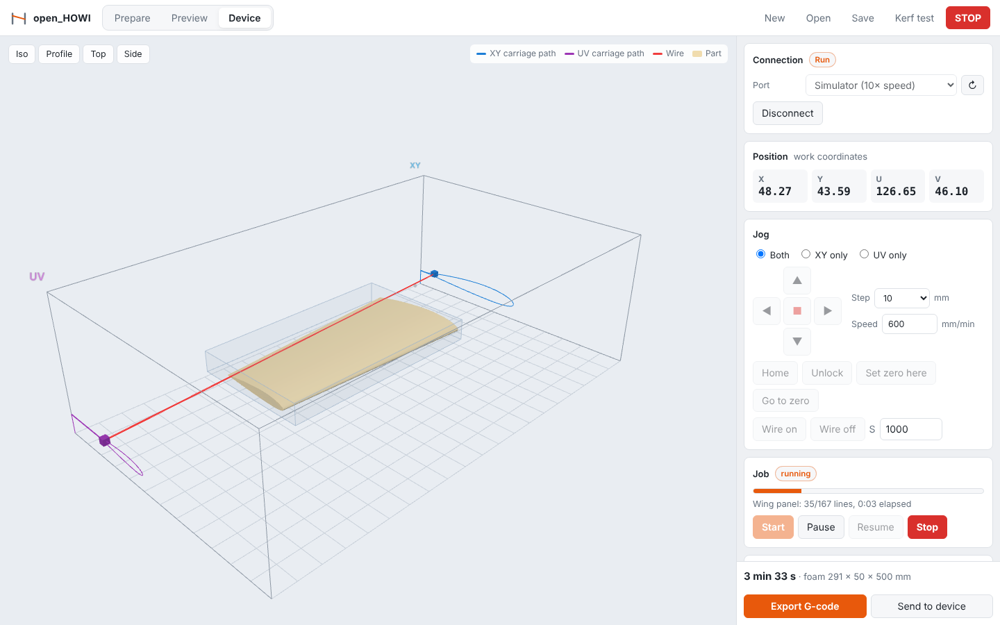

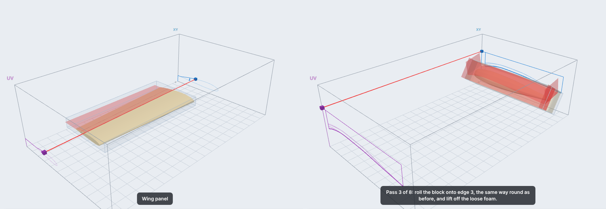

**Presets, like a slicer's printer/filament profiles:**

- *Machine*: distance between the carriages, travel, axis letters, travel speed, feed mode, baud rate.
- *Material*: cut speed, kerf at cut speed and at half speed, wire power, preheat. The built-in
  EPS / XPS / EPP presets are only starting points. Run **Kerf test** (top bar): it cuts two
  60 × 30 mm pieces, one at full speed and one at half, and you enter the measured kerf in your
  own material preset.

Your presets and airfoil library are stored in `~/.config/openhowi` (Linux),
`~/Library/Application Support/openhowi` (macOS) or `%APPDATA%\openhowi` (Windows).
Projects save as `.howi.json` files with loaded `.dat` airfoils embedded (database airfoils by id), so you can share them.

**Try it without a machine:** pick *Simulator (10× speed)* as the port in the Device tab.

### Airfoil database

Pick **Browse airfoil database…** in an airfoil field to choose from 68 common model-aircraft
sections, grouped as trainer & sport, gliders, flying wings (reflexed), symmetric & tail, high lift,
and full-size & scale, with their thickness and camber. Search by name or use (*hand launch*,
*flying wing*). You can still load any `.dat` file (Selig or Lednicer format).

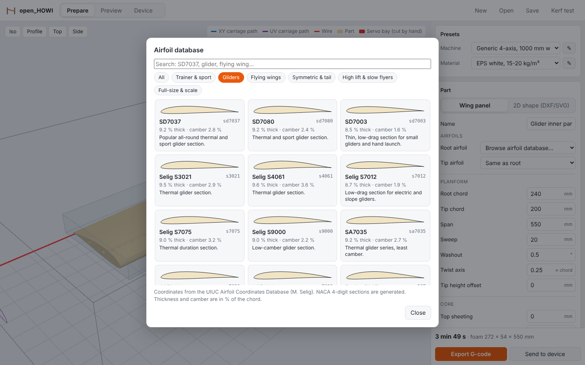

The coordinates come from the [UIUC Airfoil Coordinates Database](https://m-selig.ae.illinois.edu/ads/coord_database.html)
(see `src/openhowi/airfoils/README.md`); the NACA 4-digit sections are generated. In job files and on
the command line an airfoil is a NACA code (`naca2412`), a database id (`sd7037`) or a `.dat` file;
`openhowi airfoils` lists the ids.

### Built-up wings: sheeting, LE/TE stock, spars, channels, joiners and servo bays

For cores that get skinned, open the wing panel's **Core**, **Spars**, **Servo channels**, **Joiners**
and **Servo bays** groups:

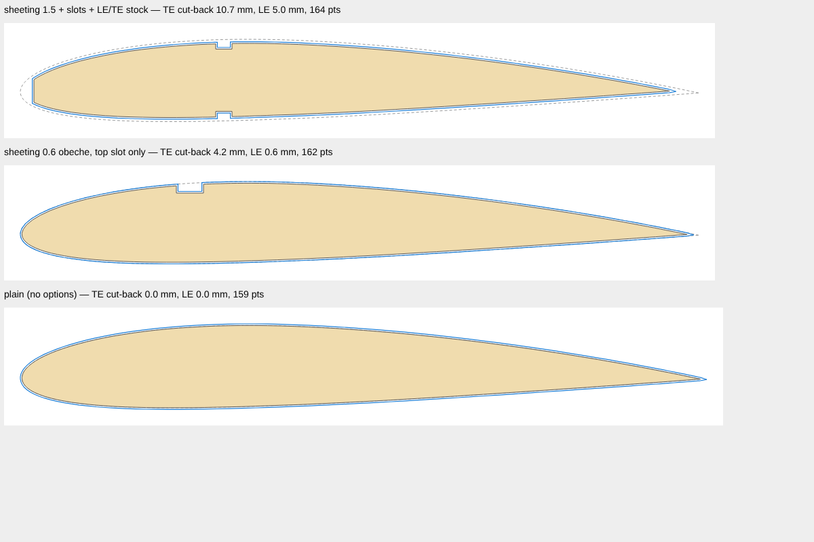

- **Sheeting** (top and bottom can differ, e.g. 1.5 mm balsa or 0.6 mm obeche): the core is cut
  undersize by that much, so the finished wing has the airfoil's shape. Near the trailing edge the
  airfoil gets thinner than the two skins together; the core stops where they meet, and the preview
  tells you how far that is from the trailing edge (the skins are glued together there, or onto a TE strip).
- **LE / TE stock**: cut the core back flat by this much (along the chord) to fit a leading-edge or
  trailing-edge strip.
- **Spars**: add as many as you need (*+ Add spar*). Each is a rectangular slot for a spar cap in the
  top and/or bottom surface, at a % of the chord (the tip can use a different position), measured
  from the core surface, i.e. under the skins.
- **Servo channels**: a round spanwise channel for servo leads (*+ Add servo channel*), at a % of the
  chord, centred in the core (or moved up or down), at the diameter you set. The wire cannot be
  lifted, so it reaches the channel through a straight slit from the bottom (or top) surface, goes
  round it and leaves along the slit; tape or sheet over the slit.
- **Joiners**: a straight hole through the whole panel for a joiner tube or rod (round) or a
  blade (rectangular), cut like a servo channel through a slit (*+ Add joiner hole*). By default it
  runs square to the root face, as most joiners do; set a *tip position* to make it follow a swept or
  tapered panel, and a *dihedral* for a straight joiner across a dihedral joint (the hole then runs
  down towards the tip by half the angle). The hole's section in each face is worked out from its
  axis, so a slanted tube still comes out round and true to size.
- **Servo bays** (*+ Add servo bay*): a pocket at a distance from the root, at a % of the local chord,
  with its length, width and depth. The wire can only cut what runs through the whole panel, so
  bays are cut by hand: open_HOWI checks that each bay fits, leaves foam under it and stays clear of
  spar slots, joiners and other bays, shows it in red in 3D, says whether a servo channel runs into
  it, and prints a **1:1 template** (*Preview → Servo bay template*, an SVG in mm) with the bays,
  slots and slits in plan view and the distances to measure from the root face and the front of
  the core.
- Anything that would leave less than 1 mm of foam, does not fit on the core, or overlaps another
  slot, channel or joiner is refused with a message saying which one. So is a layout where two cuts
  swap places between root and tip (for example a joiner square to the root of a swept panel
  crossing a spar slot): their cuts would cross inside the panel.
- Root and tip are built with the same number of points, so every slot, channel and edge runs
  straight from root to tip.

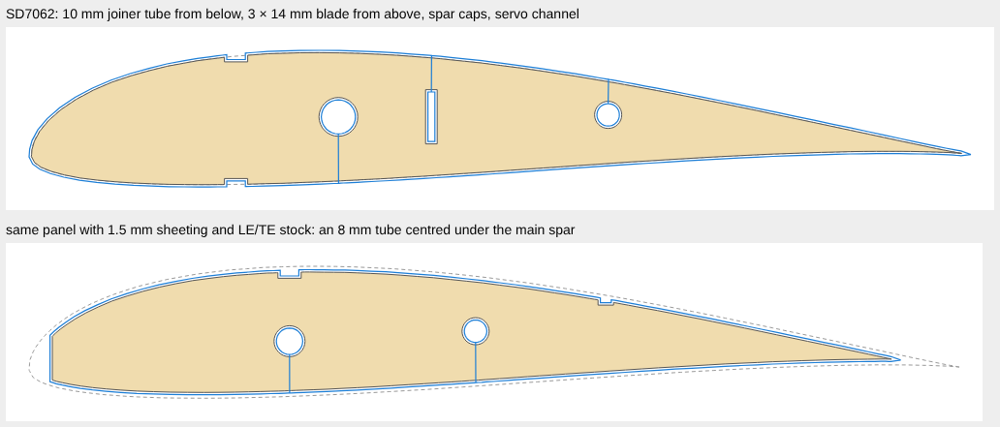

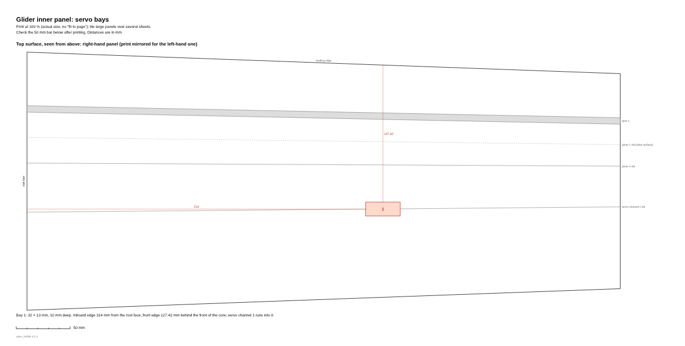

`examples/sheeted_wing.toml` shows the same options for the command line.

### Control surfaces, curved wings and nesting

**Control surfaces** (*+ Add aileron, flap or elevator*). The surface comes off in the same cut as the
panel. The wire runs down the hinge line and round a V-shaped wedge of waste in front of the surface,
so the two pieces come apart ready to hinge:

- *Hinged on top* (tape along the top surface): the V underneath lets it swing down by the V's angle;
  up is free. *Bottom* is the same upside down. *Centre line* (pinned or CA hinges) has a V above and
  below, for ± the angle. A V of 0° is a straight cut, one kerf wide.
- The hinge line is set in % of the chord at its inboard and outboard ends and runs straight. Give
  where it **starts and ends** along the span and the wing is split into panels there, because the wire
  always cuts the whole length of a panel.
- It is checked against spar slots, channels, joiners and servo bays, and the cutting steps say how to
  hinge it.

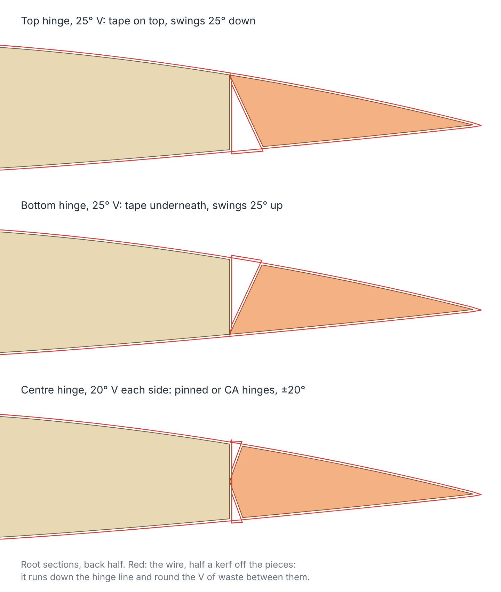

**Curved wings in straight panels.** Set *Planform* to *elliptical* (root chord, the chord where the
ellipse is cut off, half span, and which line runs straight: 0 % a straight leading edge, 25 % the
classic elliptical wing, 100 % a straight trailing edge), *from stations* (chord, leading edge, twist
and height at as many stations as you like, joined by smooth curves or straight lines), or *from a
drawing* (the half wing seen from above, root on the left: trace a picture of the plan). The wire
cuts straight edges, so the wing is cut as panels whose ends sit on the true outline and meet face to
face:

- as few panels as keep the straight edges within the tolerance of the curve (default 2 mm), or the
  number you ask for, with the error evened out; none longer than fits between the carriages, none
  shorter than *Shortest panel*;
- each panel is a cut of its own (the *Cut* selector, *Export all cuts*, one file per panel on the
  command line), with its chords, sweep, washout and airfoils blended between the root and tip
  sections. Spars and channels run straight from root to tip; joiners go in the root panel and servo
  bays in the panel they sit in;
- the cutting steps say which faces glue together and how far the panel strays from the curve.

A short panel near a strongly tapered tip swings the far carriage a long way, because the wire carries
the taper out to the carriages. If a panel runs off the machine, open_HOWI says so: use fewer or longer
panels, a larger tip chord, or move the towers closer together.

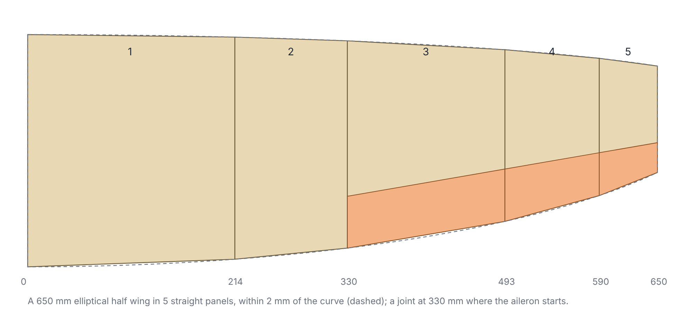

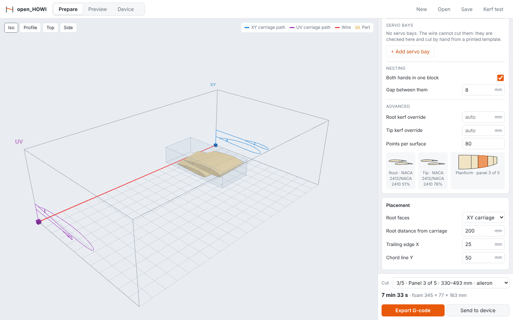

**Nesting.** *Both hands in one block* (Wing → Nesting) cuts the left and right panel in one go: the
opposite hand stacks above this one over the same stretch of wire. A **Block of parts** nests any wing
panels (or a panel of a split wing, or all of them) and 2D shapes, with copies and opposite hands, in
one block:

- parts are stacked bottom to top in columns, the first at the back of the block; when the block height
  is used up, the next column stands in front. Each part keeps clear of the others by the gap you set,
  at both ends of the block and so all along it;
- the wire reaches a part in the first column straight from behind the block. A part further forward
  is reached through a cut over the columns behind it and down the gap in front of them, and left the
  same way. The steps list where each part is;
- parts shorter than the block are cut on to its ends; a short, tapered part whose cut would turn inside
  out there is refused, with the reason.

`examples/elliptical_wing.howi.json` is the elliptical wing above; `examples/glider_block.howi.json`
nests both wing panels and both tailplane halves (with their elevators) in one block;
`examples/aileron_panel.toml` is a TOML job with an aileron.

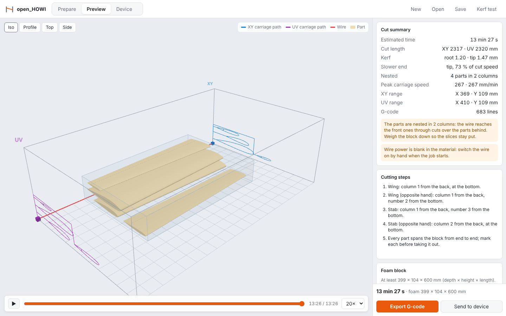

### 2D shapes from DXF or SVG

Switch the part to **2D shape** and load a drawing: fuselage formers, ribs, letters, signs, any closed outline.

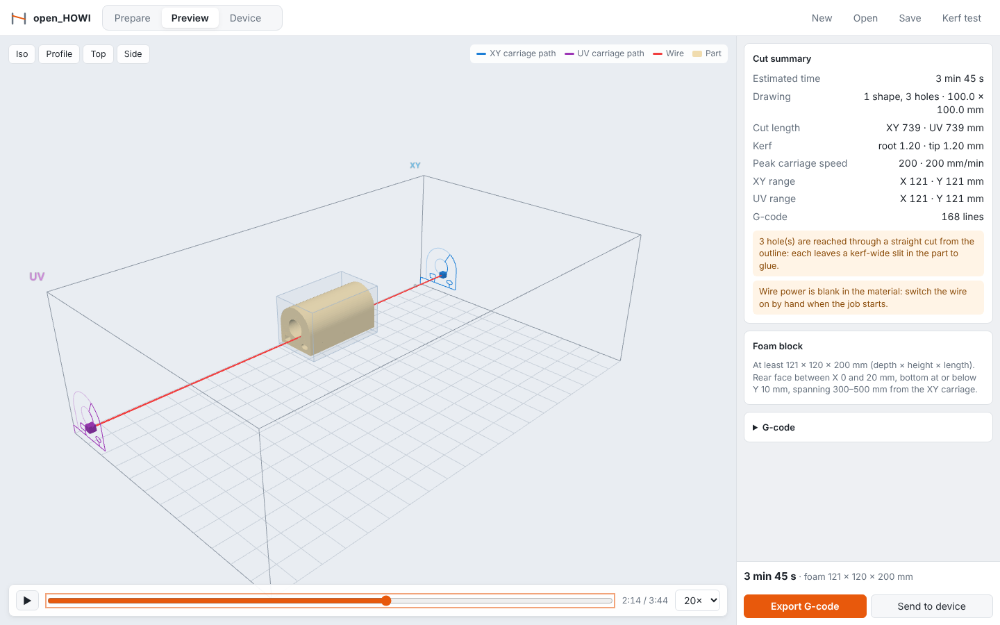

- **What is read.** SVG: paths (every command, including arcs), rect, circle, ellipse, polygon,
  polyline, line, groups, transforms and `<use>` clones, in real units (`width="100mm"` + `viewBox`).
  DXF (ASCII): LINE, LWPOLYLINE and POLYLINE with arc segments, CIRCLE, ARC, ELLIPSE, SPLINE and
  blocks (INSERT), in the drawing's `$INSUNITS`. Text must be converted to outlines first
  (Inkscape: *Path → Object to Path*); the app tells you what it skipped.
- **Outlines and holes.** Loose lines and arcs are joined into closed outlines (gaps up to 0.2 mm by
  default). An outline inside another becomes a hole; a shape inside a hole is a separate part again.
- **Scale, rotate, mirror**, set the **length along the wire**, and optionally **taper** the shape
  towards the tip face (tip scale and shift). The app refuses tapers that are too steep for where the part sits.
- **Cut planning.** Every shape is entered from behind the block (X = 0) along a horizontal lead-in
  that avoids the other shapes. Holes are cut on the way round the outline, through the shortest
  straight "bridge" cut from the outline. The wire cannot be lifted, so each hole leaves one
  kerf-wide slit in the part to glue; the preview says how many. Holes narrower than the kerf are skipped.

Try `examples/shapes/former.svg` (one shape, three holes) and `examples/shapes/star_and_d.dxf`
(two shapes, a block insert and an outline drawn as separate lines and an arc).

### Fuselages

Switch the part to **Fuselage** and describe it either with a table of **stations** (distance from the
nose, top and bottom height above a datum line, width, and how round the upper and lower half of
the section are: 100 % elliptical, 0 % square, so a flat-bottomed box with a rounded top is easy),
or by loading a **side view and a top view** drawing (DXF/SVG, nose on the left). Between stations
the lines run smoothly without overshooting.

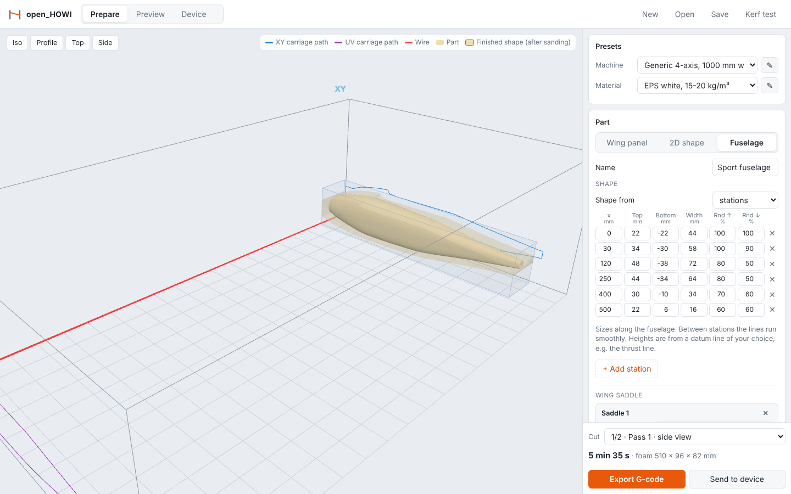

Three ways to cut it (pick the cut to slice in the selector above *Export G-code*; *Export all cuts*
writes one G-code file per cut, and *Preview → Cutting steps* shows, with drawings, how to set up and
turn the foam for each one):

- **Two views** (two passes). Pass 1 cuts the side view's top and bottom lines from one end of the
  block to the other, so the slab keeps the block's flat end faces; for pass 2 it lies on its side
  against the same stop and the top view is cut out. Round the corners off by hand, checking with
  the formers.
- **Turned** (4 to 32 passes). The block is turned about the fuselage's axis between passes, and every
  pass cuts the fuselage's outline as seen from that side, so 8 passes leave an octagonal fuselage and
  16 passes one with corners under a millimetre to sand. **Without a spinning table** the block is
  screwed between two polygon end plates (template in the cutting guide) and rolled by hand onto the
  next edge: the job pauses with the wire off and the Device tab says "roll the block onto edge 3"; press
  Resume. **With a spinning table** set the machine preset's *Rotary axis letter* (e.g. `A`, a rotary
  turning the foam about a line along X) and *Rotary axis height*: the G-code turns it between passes
  (`G0 A45`) without stopping. The turning direction does not matter, as the fuselage is symmetric.
- **Lengthwise segments.** The wire runs along the fuselage and every segment (up to the length you
  set) is a ruled surface between its two end sections, like a wing panel, so the sections come out
  **rounded**. Segments can be **hollow** (a wall thickness; a full segment is reached through a slit
  along the bottom) or cut as **left and right half shells** that need no slit and glue along the
  centre line. Each segment's larger end goes next to the carriage you measure from; when a steep
  segment would swing the far carriage below zero the app lifts the foam and tells you how much.

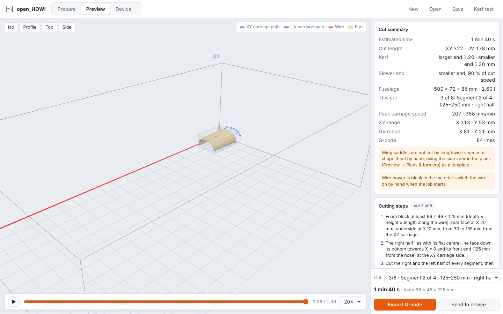

- **Wing saddles**: give the wing's airfoil (from the database), chord, leading-edge position and
  height and incidence, on top (high wing) or underneath (low wing): the fuselage's top or bottom
  line takes the airfoil's shape there, and the formers under the wing stop at it.
- **Plans & formers** (*Preview*, or `openhowi slice … --plans plans.svg`): a 1:1 SVG with the side
  and top views, the datum, the stations, the wing, every former (drawn inside the planking
  thickness you give) and the jig plates, with a 50 mm check bar.
- **Print cutting guide** (*Preview*, or `--guide guide.html`): one page to print with every cut's
  drawings and steps in order (where the foam goes, which edge goes down next), then the jig plates
  and formers at 1:1 and the views reduced. It prints true to size at 100 %.
- **3D model (STL)** (*Preview*, or `--stl fuselage.stl`): the finished fuselage as a closed mesh, to 3D
  print it (or a mould plug) or take it into CAD.

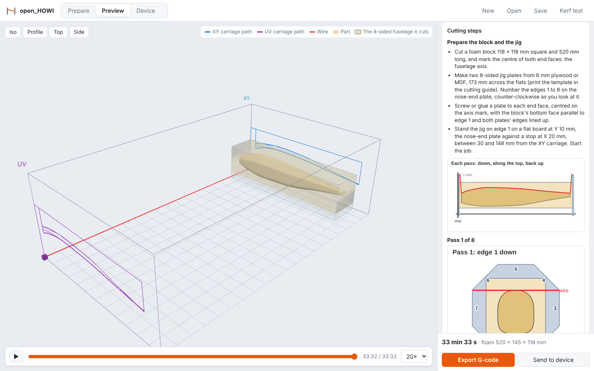

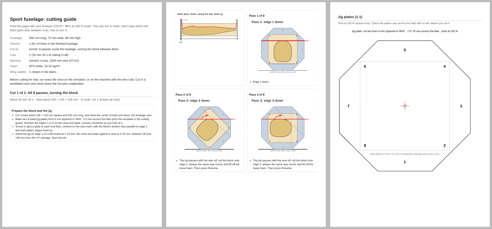

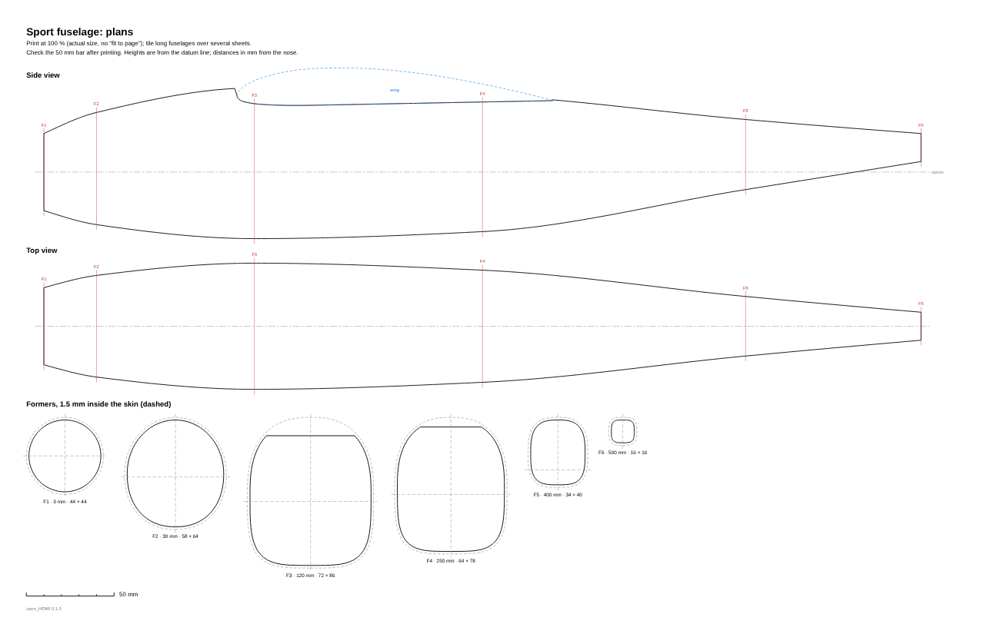

`examples/sport_fuselage.howi.json` is a ready-made fuselage with a wing saddle, and
`examples/fuselage/side.svg` / `top.svg` are the same fuselage as drawings.

**Run it on a Raspberry Pi** at the machine and use it from other computers on your network: see
[On a Raspberry Pi next to the machine](#on-a-raspberry-pi-next-to-the-machine).

## How the cut works

```
 top view (looking down on the machine)

   XY carriage                                              UV carriage
   span = 0                                                 span = tower_distance
      │                                                          │
      ●━━━━━━━━━━━━━━━━━━━━━━━━━━ hot wire ━━━━━━━━━━━━━━━━━━━━━━━●
      │          ┌──────────────── foam ────────────────┐        │
      │          │ root section               tip section│        │
      │          └───────────────────────────────────────┘        │
      │<- root_offset ->|<------------ span ------------>|        │
```

The wire is a straight line between the two carriages. To cut a tapered panel, every pair of
matching root and tip points must lie on the wire at the same moment. open_HOWI:

1. resamples the root and tip airfoils so they have the same number of points, with the
   leading and trailing edges matched (cosine spacing, dense where curvature is high);
2. scales, sweeps and twists each section and moves it outward by half its kerf. The kerf
   at each end comes from the material and how fast that end actually moves. On a tapered
   panel the narrow end moves more slowly and melts a wider slot;
3. extends the line through each root/tip pair out to both carriages. These are the paths
   the XY and UV axes must follow;
4. times each segment so the wire never moves through the foam faster than the cut speed
   at either end of the part. Both carriages arrive together; the outer one may move faster.

In machine coordinates the trailing edge faces the origin. The wire rises at X=0 (behind the
foam), cuts in to the trailing edge, goes over the upper surface (through any spar slot) to the
leading edge, back under the lower surface, up the trailing-edge face of a blunt or cut-back core,
out the entry slot, and returns to the origin. Start every job with
both carriages at the origin. Use **Set zero here** in the Device tab to choose where that is.

## Hardware

Any controller that accepts 4-axis G-code over USB works. A common, inexpensive setup is
an **Arduino Mega 2560 + RAMPS 1.4** (or similar) running a 4-axis GRBL 1.1 build such as
**Grbl-Mega-5X**:

- set the machine preset's *axis letters* to the letters your firmware uses, e.g. `XYUV` or `XYZA`.
  The firmware must report the axes in that order;
- if the wire's power supply is switched or PWM-controlled from the spindle output, set the
  material's *wire power* to the `S` value for M3 (relative to GRBL's `$30`), and turn laser
  mode off (`$32=0`) so the wire stays hot during every move. Otherwise leave it blank and
  switch the wire by hand;
- set steps/mm and max rates (`$100`… / `$110`…) for each axis as usual.

G-code uses inverse-time feed (G93) by default, because every controller reads it the same
way. Switch the machine preset to *Units per minute (G94)* only if yours lacks G93.

## Command line

```bash
openhowi slice my-wing.howi.json -o my-wing.gcode   # slice a project saved from the app
openhowi slice examples/sport_fuselage.howi.json --plans plans.svg --guide guide.html --stl fuse.stl
                                                     # one G-code file per cut, 1:1 plans, printable guide, 3D model
openhowi shape former.svg --span 80 --material "XPS extruded (blue/pink)"   # cut a DXF/SVG drawing
openhowi wing examples/tapered_wing.toml --svg wing.svg   # TOML job file, explicit kerf values
openhowi wing examples/sheeted_wing.toml --bay-template bays.svg   # built-up core + 1:1 servo bay template
openhowi wing examples/aileron_panel.toml            # a panel with its aileron cut off ([wing.control])
openhowi slice examples/elliptical_wing.howi.json    # one G-code file per panel
openhowi airfoils glider                             # search the airfoil database
openhowi airfoils --export sd7037 -o sd7037.dat      # write a database airfoil as a .dat file
openhowi send wing.gcode --port /dev/ttyACM0         # stream to GRBL (COM3 etc. on Windows)
openhowi send wing.gcode --dry-run                   # check a file without a machine
openhowi naca 2412 -o naca2412.dat                   # write a NACA 4-digit airfoil
```

`examples/tapered_wing.toml` documents every option of the TOML job format.

## Safety

- Hot-wire cutting expanded polystyrene and similar foams gives off fumes. Cut in a well
  ventilated area.
- The wire is hot enough to burn. Keep the power supply's current limited, and never leave
  a hot wire still inside the foam or unattended.
- Run new G-code on the simulator, or once on the machine with the wire cold, before cutting.

## Roadmap

- Nesting: parts side by side within a column, and lead-ins from below or the side when shapes block each other
- Rotate planform: cut a swept panel with its trailing edge along the block
- Wing-root dowel and hold-down holes on the template; cutting short joiner holes with a heated tube
- Homing/limit-aware placement and a block-size optimiser
- Fuselages: sections from drawn formers (lofts between two different drawings), fin slots and hatch lines
- Continuous rotary (lathe-style) cutting for bodies of revolution such as spinners
- Signed installers (Windows code signing, Apple notarisation) and an Intel Mac build

## Development

```bash
pip install -e '.[dev]'
pytest
ruff check src tests && ruff format --check src tests
```

| Module | |
|---|---|
| `airfoil`, `airfoildb`, `geometry`, `wing`, `core` | Airfoil parsing/generation and the airfoil database, 2D geometry, wing sections with sheeting, stock, slots, channels, joiners, servo bays and control surfaces |
| `planform`, `nest` | Wing planforms and splitting curved ones into straight panels; nesting several parts in one block |
| `svgimport`, `dxfimport`, `curves`, `shapes` | Drawing import, curve flattening, outlines/holes, kerf and cut planning for 2D shapes |
| `fuselage`, `fusecut` | Fuselage stations/views, rounded sections, saddles, STL; two-view, turned and lengthwise cuts |
| `diagrams`, `guide` | Step drawings (how the foam sits and turns) and the printable cutting guide |
| `toolpath`, `gcode` | Placement, the 4-axis projection, feed timing and G-code output |
| `material`, `presets`, `project`, `calibration`, `template` | Slicer layer: presets, kerf model, project slicing, kerf test, servo bay template and fuselage plans |
| `simulator`, `controller`, `sender` | Simulated GRBL, the threaded device controller, the CLI streamer |
| `server`, `web/` | Local HTTP API and the browser UI (three.js r179 vendored under `web/vendor`) |
| `desktop`, `packaging/` | The app window (pywebview: menu, file dialogs, one copy) and the installers; `packaging/raspberry-pi/install.sh` sets up a Pi |

## License

open_HOWI is free software: you can redistribute it and/or modify it under the terms of the
[GNU General Public License](LICENSE) as published by the Free Software Foundation, either
version 3 of the License, or (at your option) any later version.

The bundled three.js (`src/openhowi/web/vendor/three`) is MIT licensed. The airfoil coordinates in
`src/openhowi/airfoils` come from the UIUC Airfoil Coordinates Database, by way of AeroSandbox (MIT);
see the README in that folder.
